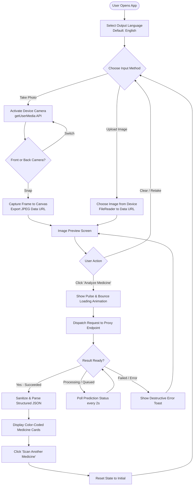
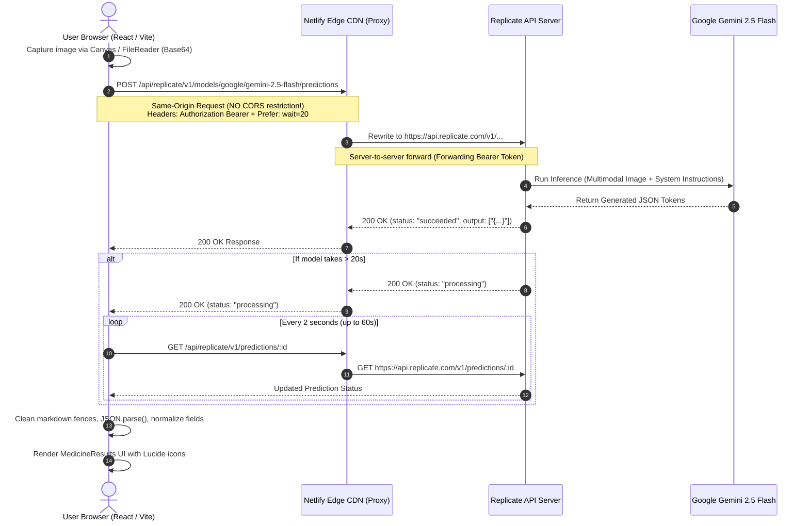

# MediGuide AI: Architecture, App Flow & Interview Preparation Guide

---

## 1. Simple Explanation of the Project

### The "Elevator Pitch"
> **MediGuide AI** is an intelligent web application that turns any smartphone or computer camera into a personal medical assistant. Users simply snap a photo or upload an image of any medicine (box, blister strip, bottle, or tablet), choose their preferred language, and instantly receive clear, reliable, and structured medical information—including uses, dosage, timing, side effects, and warnings.

### In Simple Layman Terms: How It Works
1. **Snap or Upload:** You hold a medicine box or strip up to your camera, or pick an existing image from your phone's photo library.
2. **Pick Your Language:** You can select from 19 languages (such as English, Hindi, Spanish, Urdu, Arabic, etc.).
3. **Instant AI Analysis:** The app sends the image to Google's **Gemini 2.5 Flash** vision model via Replicate.
4. **Clear Medical Guide:** Within 1–2 seconds, the app displays a color-coded breakdown answering:
   - What is this medicine and what category does it belong to?
   - What conditions does it treat?
   - When and how should I take it (with food, morning/night)?
   - What are the major precautions, side effects, and drug interactions to avoid?

---

## 2. Application Flow & Architecture Maps

### A. End-to-End User Experience Flow



---

### B. Core AI & Prompting Workflow (Upload $\rightarrow$ AI $\rightarrow$ Display)

```mermaid
flowchart TD
    %% Step 1: User Upload
    A["📸 1. User Uploads Image<br/>(Camera snapshot or File from Gallery)"] --> B["🔄 2. Convert to Base64 Data URL<br/>(Turns image into text format: data:image/jpeg;base64,...)"]

    %% Step 2: Prompt Engineering
    B --> C["📝 3. Prompt & System Instruction Assembly<br/>• Injects pharmacist persona<br/>• Sets target language (e.g. Hindi, Spanish)<br/>• Enforces strict 9-field JSON schema"]

    %% Step 3: Network Proxy
    C --> D["🛡️ 4. Forward to Netlify / Vite Proxy (/api/replicate/...)<br/>• Eliminates browser CORS errors<br/>• Same-origin request to CDN edge"]

    %% Step 4: Replicate & Gemini
    D --> E["☁️ 5. Replicate API Receives Payload<br/>Routes job to Google Gemini 2.5 Flash"]
    E --> F["🧠 6. Gemini 2.5 Flash Vision Model Runs:<br/>• OCR: Reads text & dosage on box/strip<br/>• Visual Check: Identifies pill shape & branding<br/>• Medical Knowledge: Formulates uses, dosage, precautions<br/>• Translates output into selected language"]

    %% Step 5: Response
    F --> G["📦 7. Replicate Returns Response<br/>HTTP 200 with JSON output string"]

    %% Step 6: Cleaning & Parsing
    G --> H["🧹 8. Frontend Cleans & Parses:<br/>• Strips markdown code blocks (```json)<br/>• Extracts pure JSON object<br/>• Schema normalization & fallbacks"]

    %% Step 7: UI Display
    H --> I["🎉 9. UI Renders Medicine Cards<br/>Shows 7 Color-Coded Sections<br/>(Name, Dosage, Uses, Side Effects, Warnings)"]

    style A fill:#e0f2fe,stroke:#0284c7,stroke-width:2px
    style C fill:#fef3c7,stroke:#d97706,stroke-width:2px
    style E fill:#f3e8ff,stroke:#9333ea,stroke-width:2px
    style F fill:#dcfce7,stroke:#16a34a,stroke-width:2px
    style H fill:#ffedd5,stroke:#ea580c,stroke-width:2px
    style I fill:#ecfdf5,stroke:#059669,stroke-width:3px
```



---

### C. Technical System & Network Architecture



---

## 3. Key Technical Decisions & Innovations

| Feature | Why & How We Built It |
| :--- | :--- |
| **Google Gemini 2.5 Flash via Replicate** | Chosen for high inference speed (~1.2s response time), state-of-the-art OCR/vision capabilities on packaging/blister packs, and cost efficiency. |
| **Bypassing Browser CORS via Netlify Edge Proxy** | Replicate's API does not include `Access-Control-Allow-Origin` headers. By creating `netlify.toml` and `public/_redirects` proxy rules (`/api/replicate/*` $\rightarrow$ `https://api.replicate.com/:splat`), the browser calls same-origin, preventing CORS blocks. |
| **Synchronous Wait (`Prefer: wait=20`) with Asynchronous Polling Fallback** | Avoids holding connections past Netlify's 26s proxy timeout. Fast requests finish instantly, while longer jobs gracefully fall back to interval polling. |
| **Resilient JSON Output Sanitization** | Large language models often wrap JSON in ```` ```json ```` markdown fences. The parsing algorithm cleans code tags and uses regex boundary indexing (`firstBrace` to `lastBrace`) to avoid crashes. |
| **Multilingual Medical Translation** | System instructions enforce strict JSON field responses localized directly into any of 19 user-selected languages without requiring an external translation API. |

---

## 4. The Most Obvious & Basic Questions (Asked in 99% of Interviews)

These are the fundamental, conversational questions interviewers ask first to gauge whether you genuinely built and understand the project.

---

### Q1: What is this project and what does it do?
> **Model Answer:**  
> "MediGuide AI is a web application that helps people understand their medications. Users take a picture of any medicine packaging, bottle, or pill using their phone camera or upload an image. The app uses Google's Gemini 2.5 Flash AI model to recognize the medicine, read the text, and give back a simple, color-coded summary explaining what the medicine is, what conditions it treats, recommended dosages, when to take it, common side effects, and important warnings in 19 different languages."

---

### Q2: What was your motivation for building this project?
> **Model Answer:**  
> "Medicine packaging is notoriously difficult to read—the text is tiny, names are complicated chemical formulas, and instructions are often in a language the patient might not be fluent in. For elderly people or patients with multiple prescriptions, this leads to accidental dosage mistakes. I wanted to build a simple, accessible tool where anyone can snap a photo and immediately understand how to take their medication safely in their own native language."

---

### Q3: What is your tech stack and why did you pick each technology?
> **Model Answer:**  
> - **React 18:** For building a reactive, component-based user interface with instant state transitions.
> - **TypeScript:** To ensure strict type safety for our medicine data schema (`MedicineInfo`), eliminating runtime null or undefined bugs.
> - **Vite:** For ultra-fast development startup and lightweight, optimized production bundles compared to older tools like Webpack.
> - **Tailwind CSS & Shadcn UI:** For clean, professional medical-grade styling, responsive mobile layout, and accessible UI components.
> - **Replicate API:** To run Google's Gemini 2.5 Flash model in the cloud without needing local GPU hardware.
> - **Google Gemini 2.5 Flash:** A high-speed, multimodal vision AI model capable of reading packaging text and visual layouts in ~1.2 seconds.
> - **Netlify:** For zero-config hosting with edge proxy routing to prevent browser CORS issues.

---

### Q4: What is Replicate and what role does it play in this app?
> **Model Answer:**  
> "Replicate is a cloud platform that hosts and runs machine learning models via simple API calls. Instead of having to rent an expensive GPU server or configure complex model hosting, Replicate provides an HTTP endpoint (`api.replicate.com`). We send the image and prompt in a standard JSON request, and Replicate spins up the model, executes the inference, and returns the result."

---

### Q5: What is Gemini 2.5 Flash? Why use it instead of GPT-4 or Claude?
> **Model Answer:**  
> "Gemini 2.5 Flash is Google's multimodal AI model optimized specifically for speed, cost-efficiency, and vision tasks.  
> 1. **Multimodal by design:** It doesn't just read OCR text; it visually understands packaging layouts, logos, and tablet shapes.  
> 2. **Incredible Speed:** It completes image reasoning in roughly 1 to 1.5 seconds.  
> 3. **Cost-effective:** Flash models are significantly cheaper than frontier models like GPT-4o while being more than capable for structured medical extraction."

---

### Q6: How does the image get from the user's phone to the AI model?
> **Model Answer:**  
> "When the user takes a photo or selects a file, the browser uses the HTML5 Canvas or `FileReader` API to convert the image into a **Base64 Data URI** string (e.g., `data:image/jpeg;base64,/9j/4AAQSkZJRg...`). This string represents the raw image pixels in standard text characters. We place this string into the `images` array of the JSON request payload sent to the API."

---

### Q7: What is an API key and how did you keep it secure?
> **Model Answer:**  
> "An API key is a secret authentication token that identifies our account to Replicate and authorizes billing.  
> - **Locally:** It is saved in a `.env` file that is listed in `.gitignore` so it is never pushed to public GitHub repositories. We also created a `.env.example` file with blank placeholders for team collaboration.  
> - **In Production:** The key is configured securely inside Netlify's Environment Variables settings."

---

### Q8: What is CORS, and why did you get a CORS error on Netlify?
> **Model Answer:**  
> "CORS stands for **Cross-Origin Resource Sharing**. It is a browser security mechanism that blocks web pages from making HTTP requests to a different domain unless that domain explicitly permits it with an `Access-Control-Allow-Origin` header.  
> 
> Replicate does not send CORS headers because it is designed for backend servers. When our app on `marufmediguide.netlify.app` tried calling `api.replicate.com` directly, the browser blocked it.  
> 
> We solved this by setting up a **proxy rewrite** in `netlify.toml` and `_redirects`. When the app calls `/api/replicate/...`, the browser talks to Netlify (same origin), and Netlify's server forwards the request to Replicate behind the scenes."

---

### Q9: What is Vite and why did you use it instead of Create React App (CRA)?
> **Model Answer:**  
> "Create React App is deprecated and relies on Webpack, which bundles the entire project before starting the dev server, making it sluggish as apps grow.  
> 
> Vite uses native browser ES Modules (ESM) and an ultra-fast Go-based compiler called esbuild. The dev server boots in under 100ms, features near-instant Hot Module Replacement (HMR), and generates smaller, cleaner production bundles."

---

### Q10: Why did you use TypeScript instead of plain JavaScript?
> **Model Answer:**  
> "In a healthcare app, data structure accuracy is paramount. With TypeScript, we defined the `MedicineInfo` interface with strict types for all 9 fields (`name`, `dosage`, `warnings`, etc.). If a component tries to access an invalid property or forgets to handle null states, TypeScript catches it at compile time rather than letting the app crash in front of a real user."

---

### Q11: What happens if a user uploads a photo of an apple, a car, or a blurry image?
> **Model Answer:**  
> "We handled this in the prompt and schema normalization:
> 1. The system prompt instructs Gemini: *'If you cannot identify the medicine clearly, provide your best assessment based on what is visible, or clearly indicate precautions in the warnings field.'*
> 2. If the user uploads a non-medicine item, the model returns `'Unknown / Not a medicine'` and advises the user to rescan a clearer picture in the `warnings` section.
> 3. In the frontend, our normalization logic provides fallback defaults for any blank or missing fields so the UI never displays broken or undefined cards."

---

### Q12: What happens if the internet goes down or the AI server fails?
> **Model Answer:**  
> "The hook wraps the API call in a `try...catch...finally` block:
> - If the network drops or Replicate returns a 4xx/5xx status, the error is caught immediately.
> - A user-friendly error notification is displayed using the Sonner toast component (`'Failed to analyze medicine'`).
> - The `isAnalyzing` loading spinner is turned off in the `finally` block so the UI is never stuck in a frozen state."

---

### Q13: Is this app meant to replace a real doctor or pharmacist?
> **Model Answer:**  
> "Absolutely not. This is strictly an informational accessibility aid. We make this clear by appending safety disclaimers to every result: *'Keep out of reach of children. Consult a healthcare professional before use.'* The app is designed to help patients understand label instructions, not to prescribe treatments or diagnose illnesses."

---

### Q14: How did you test this application?
> **Model Answer:**  
> "We tested on three levels:
> 1. **Unit Testing:** Using **Vitest** and **React Testing Library** in [`src/test/useMedicineAnalysis.test.ts`](file:///Users/razinshk/Downloads/MediGuide-AI-main/src/test/useMedicineAnalysis.test.ts) to verify hook state transitions, Replicate Gemini 2.5 Flash response parsing, and state reset functionality.
> 2. **Build Verification:** Tested production bundling using `npm run build` to verify clean TypeScript compilation and asset generation.
> 3. **Manual Cross-Device Testing:** Tested native camera stream and file uploads across mobile and desktop browsers to verify responsive layout and language translations."

---

## 5. Advanced Technical & Architectural Questions

---

### Q15: How did you implement native camera capture in the browser without third-party camera libraries?
> **Model Answer:**  
> "I used the browser's native `navigator.mediaDevices.getUserMedia` API coupled with an HTML5 `<video>` and hidden `<canvas>` element:
> - The video stream is attached to `videoRef.current.srcObject`.
> - Users can switch between the front and rear cameras using the `facingMode` constraint (`'environment'` vs `'user'`).
> - When snapping a photo, the frame is drawn onto the hidden canvas using `ctx.drawImage()`, accounting for camera mirroring if using the front camera (`scaleX(-1)`).
> - Finally, `canvas.toDataURL('image/jpeg', 0.9)` generates an optimized JPEG Data URI that can be previewed or sent directly to the model.
> - On component unmount or camera close, all active media tracks are stopped via `track.stop()` to release device hardware."

---

### Q16: How is state managed in the application? Why custom hooks over Redux/Zustand?
> **Model Answer:**  
> "The state for this application is encapsulated inside the custom [`useMedicineAnalysis`](file:///Users/razinshk/Downloads/MediGuide-AI-main/src/hooks/useMedicineAnalysis.ts) hook:
> - `isAnalyzing`: Boolean loading state driving UI animations.
> - `medicineInfo`: Nullable typed `MedicineInfo` object storing the structured response.
> - `error`: Error state string.
> 
> For an application with a focused single-page workflow (Scan $\rightarrow$ Analyze $\rightarrow$ Display $\rightarrow$ Reset), introducing a global state management library like Redux or Zustand would introduce unnecessary boilerplate. A custom React hook provides encapsulation, reusable testability, and clean separation of concerns."

---

### Q17: LLMs are non-deterministic. How did you guarantee that Gemini 2.5 Flash always returns valid JSON that matches your TypeScript interface?
> **Model Answer:**  
> "I used a defense-in-depth approach:
> 1. **Prompt & System Instructions:** In the system instruction, the model is directed to act as an expert pharmacist and reply strictly in valid JSON format matching an exact schema with no introductory or trailing text.
> 2. **Low Temperature:** Set `temperature: 0.2` to minimize creative hallucinations and maximize deterministic formatting.
> 3. **Fence Cleaning & Boundary Slicing:** Stripped Markdown code fences (```` ```json ````) and used `indexOf('{')` and `lastIndexOf('}')` to slice out the exact JSON object even if the model inadvertently added leading or trailing whitespace.
> 4. **Schema Normalization Fallback:** In the hook, all parsed properties have fallback operators (e.g., `parsed.dosage || parsed.dose || 'Consult healthcare professional'`) to guarantee that every field expected by the UI is defined."

---

### Q18: Netlify proxy redirects have a hard 26-second timeout limit. How does your integration avoid breaking when the model takes long to respond?
> **Model Answer:**  
> "Replicate allows passing a `Prefer: wait=<seconds>` header. Instead of setting a 60-second wait that would trigger a 504 Gateway Timeout on Netlify's 26s proxy limit, I set `Prefer: wait=20`.  
> 
> If Gemini completes in under 20s (which is typical at ~1.2s), Replicate returns the result synchronously in that single request. If it exceeds 20s, Replicate returns HTTP 200 with `status: 'processing'`, and the hook smoothly transitions to polling `/api/replicate/v1/predictions/:id` every 2 seconds until completion."

---

### Q19: If you had another sprint on this project, what enhancements would you prioritize?
> **Model Answer:**  
> 1. **Drug-Drug Interaction Checker:** Allow users to scan multiple medicines and have the AI cross-reference active ingredients against FDA contraindication databases.
> 2. **Medicine Schedule & Reminders:** Add local browser push notifications or calendar export for prescribed dosages.
> 3. **PWA & Offline Fallback:** Convert the web app to a Progressive Web App (PWA) with client-side caching of previously scanned medicines so users can review instructions without an active internet connection.
> 4. **Voice Narration (Text-to-Speech):** Integrate Web Speech API so visually impaired users can listen to the medicine instructions read aloud in their native language.
